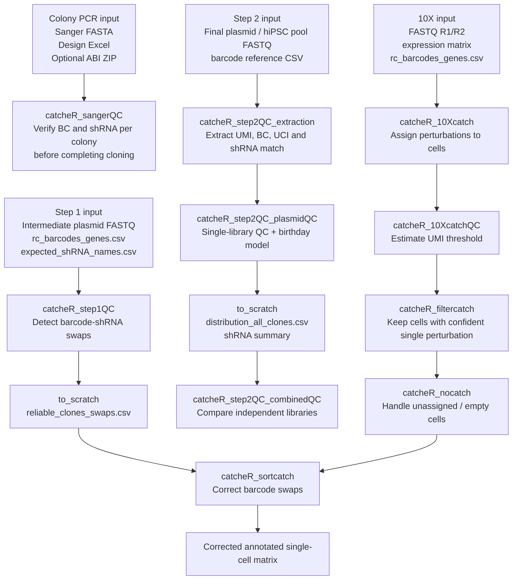

# catcheR

**Clonality And Treatment Controlled shRNA Effect findeR**

`catcheR` is an R package for iPS2-seq / CATCHER experiments. It provides native, non-Docker wrappers for plasmid-pool quality control, single-cell perturbation assignment across **three chemistries — 10X Genomics, PIPseq (Fluent) and Parse Evercode** — assignment-threshold QC, filtering, empty-cell recovery, and barcode-swap correction.

This repository is an updated implementation of the original [`alessandro-bertero/catcheR`](https://github.com/alessandro-bertero/catcheR) workflow, adapted to run directly on local machines or HPC/server environments without Docker wrappers.

---

## Features

| | what you get | where it is explained |
|---|---|---|
| **Plasmid QC** | colony-PCR Sanger QC, intermediate-pool QC, final pool / hiPSC pool extraction and QC, two-library comparison | README sections below |
| **10x assignment** | `catcheR_tenxcatch()` - native R, streams the FASTQ, corrects the cell barcode against a whitelist, UMI-deduplicated | [docs/pipeline-10x.md](docs/pipeline-10x.md) |
| **PIPseq assignment** | `catcheR_pipcatch()` - parses the four-tier barcode with its 0-3 nt phasing; read-counted (no deduplicable index) | [docs/pipeline-pipseq.md](docs/pipeline-pipseq.md) |
| **Parse assignment** | `catcheR_parsecatch()` - three ligation rounds corrected against `barcode_data.csv`, several sublibraries in one call, UMI-deduplicated | [docs/pipeline-parse.md](docs/pipeline-parse.md) |
| **Cross-chemistry comparison** | `catcheR_compare_chemistries()` - one table and one figure from runs you already have, no re-streaming | [docs/pipeline-comparison.md](docs/pipeline-comparison.md) |
| **Threshold diagnostics** | `catcheR_call_accuracy()` scores calls as correct / wrong / absent by subsampling; `catcheR_threshold_sweep()` shows what moving `percentage` actually converts | "Choosing the calling thresholds" below |
| **Downstream** | re-filter, empty-cell recovery, Seurat join with per-cell annotation, barcode-swap correction | sections below |
| **Thresholds you read off a figure** | leave `min.cell.UMI` out and the re-filter writes the yield-versus-error curve and the accuracy table, then set it with `catcheR_*_filtercatch()` | [Choosing the calling thresholds](#choosing-the-calling-thresholds) |
| **Documented data flow** | four ordered steps, one output folder per chemistry, one per threshold set, and an explicit `to.scratch` handoff | [docs/data-flow.md](docs/data-flow.md) |
| **Reproducible templates** | one parameterised R Markdown per chemistry plus one for the comparison, all on the same `scratch/` + `Output/<chemistry>/` layout | ["Analysis templates"](#analysis-templates) |

Everything runs natively: no Docker, and no shell tools except in the legacy
`catcheR_10Xcatch()` path.

---

## What catcheR does

In iPS2-seq, each perturbation is represented by a linked molecular identity:

- **shRNA**: perturbation sequence targeting a gene.
- **BC / barcode**: short sequence associated with a specific shRNA.
- **UCI**: unique clonal identifier generated during the PCR/cloning strategy.
- **UMI**: molecular identifier used in single-cell sequencing data to remove PCR duplicates.
- **Clone**: usually represented as a barcode + UCI combination.

The package covers the core CATCHER workflow:

1. QC of intermediate plasmid pools to detect barcode-shRNA swaps.
2. QC of final plasmid or edited hiPSC pools to assess shRNA representation.
3. Assignment of shRNA perturbations to 10X single-cell transcriptomes.
4. QC and threshold selection for perturbation assignment.
5. Filtering cells assigned to a single perturbation.
6. Recovering unassigned / empty cells when appropriate.
7. Correcting barcode swaps in the final single-cell matrix.

---

## Single-cell chemistries

The cassette is the same in all three; what differs is which read carries it,
how the cell barcode is built, and whether there is a usable UMI.

|  | 10X Genomics | PIPseq (Fluent) | Parse Evercode |
|---|---|---|---|
| entry point | `catcheR_tenxcatch()` | `catcheR_pipcatch()` | `catcheR_parsecatch()` |
| cassette on | read 2 | read 2 | **read 1**, reverse complement |
| cell barcode on | read 1, fixed 16 nt slice | read 1, four tiers with 0-3 nt phasing | read 2, three ligation rounds |
| needs a barcode whitelist | no | no | **yes** - split-pipe's `barcode_data.csv` |
| molecular index | 12 nt UMI | 3 nt, **not** deduplicable | 10 nt UMI |
| implementation | pure R | pure R | pure R |
| default `ratio` | 2 | 2 | 2 |
| explanation | [docs/pipeline-10x.md](docs/pipeline-10x.md) | [docs/pipeline-pipseq.md](docs/pipeline-pipseq.md) | [docs/pipeline-parse.md](docs/pipeline-parse.md) |

`catcheR_10Xcatch()`, the original shell-driven 10X entry point, is still in the
package and unchanged. `catcheR_tenxcatch()` is its native-R replacement and is
the recommended path: it needs no shell tools, writes only into `output_dir`,
and shares its whole downstream half with the other two chemistries — which is
what makes [`catcheR_compare_chemistries()`](docs/pipeline-comparison.md)
possible.

### Figures written

Every run writes catcheR's own 13 plots under their original names (`.jpg` and
`.pdf`) plus the PNG panels below, named for the chemistry of the run. The PNG
panels have no `catcheR_10Xcatch` equivalent: they answer the questions that
only arise once the data is UMI-deduplicated and there is a called-cell list to
judge the result against.

| panel | what it answers |
|---|---|
| `*_detection_funnel.png` | where the reads go, per sublibrary and pooled |
| `*_barcode_rank.png` | which barcodes are cells; knee vs the called-cell count |
| `*_saturation.png` + `.csv` | would more sequencing help (exact rarefaction, no extrapolation) |
| `*_UCI_per_cell.png` | clone composition against the per-cell UMI floor |
| `*_UCI_per_cell_called.png` | the same, restricted to the called cells |
| `*_called_composition.png` + `.csv` | composition on a fixed called-cell denominator |
| `*_yield_vs_error.png` + `.csv` | cells kept vs expected wrong calls, against the UMI floor |
| `*_call_accuracy.png` | correct / wrong / no call against depth |
| `*_threshold_sweep.png` | what `percentage` and `UMI.count` trade off |
| `*_cell_detection.png` | barcodes surviving each step |
| `*_nocall_fates.png` | what the cells without a call contain |
| `*_shRNA_clone_matrix.png` | constructs detected and clones per construct |
| `*_QC_distributions.png` | barcode and gene distributions |
| `*_QC_thresholds.png` | threshold diagnostics at extraction |
| `*_filtercatch_thresholds.png` | the same, recomputed after re-filtering |

The last three need `called.cells` — the cell list the chemistry's own
pipeline called (`cell_metadata.csv[.gz]` for Parse). Without it they are
skipped, because the barcodes this package observes include an ambient floor
that was never called as a cell, and a detection rate over all barcodes
overstates coverage.

The 2D percentage-vs-UMIxUCI panels aggregate by coordinate and scale the
marker area, which is catcheR's own `geom_count()` geometry. `jitter = TRUE`
draws the point cloud instead; it is not selected automatically, because on a
log axis the vertical jitter smears the large low-value stacks into opaque
blocks.
| default `UMI.count` | 0 | 0 | 1 |

Three consequences worth internalising before comparing results across them:

- **PIPseq has no usable UMI.** Its 3 nt index is too short to deduplicate, so
  everything called `UMIxUCI` is a *read* count on that chemistry. Depth
  comparisons against the other two are not like for like.
- **Parse reuses well combinations across sublibraries.** The same 24 nt
  barcode in two sublibraries is two different cells, so cell IDs are emitted
  in split-pipe's own `bc_wells` form (`01_01_59__s1`), suffix included, and
  join directly to `cell_metadata.csv`.
- **The cassette is sliced relative to the vector constant, not the
  reference.** About 5% of cassette-bearing reads carry a sequencing error
  inside the 15 nt reference anchor; anchoring on the constant recovers them
  with the right barcode, and what else gets through carries no valid barcode
  and is dropped at the reference lookup.

---

## Pipeline overview



---

## Installation

Install from GitHub:

```r
install.packages("devtools")
devtools::install_github("ebalmas/catcheR", ref = "V4")
```

Or from a release tarball, which needs no `devtools`:

```r
install.packages("catcheR_0.4.0.tar.gz", repos = NULL, type = "source")
```

Or from a local clone, which is what you want while editing the package:

```bash
git clone -b V4 https://github.com/ebalmas/catcheR.git
R CMD INSTALL catcheR
```

Load the package:

```r
library(catcheR)
```

Recommended R packages:

```r
install.packages(c(
  "ggplot2", "dplyr", "tidyr", "scales", "forcats",
  "patchwork", "data.table", "quantmod", "readxl"
))
```

Optional, each needed by exactly one thing:

| package | needed for |
|---|---|
| `Seurat` | the `*_seurat()` join to an expression matrix |
| `Matrix` | reading a Parse `count_matrix.mtx.gz` |
| `hdf5r` | passing Cell Ranger's `filtered_feature_bc_matrix.h5` as the cell list (a `barcodes.tsv.gz` needs nothing) |
| `rmarkdown` + `knitr` | knitting the analysis templates |

Python 3 is required for `catcheR_step2QC_extraction()`.

---

## Recommended project organization

A reproducible analysis folder can be organized like this:

```text
project/
  scripts/
    n00_import.Rmd
    n01_QC.Rmd
    n02_catcher.Rmd
  scratch/
    # temporary input files copied from to_scratch/ when restarting from checkpoints
  Output/
    step1QC/
    step2QC_extraction/
    step2QC_plasmidQC/
    step2QC_combinedQC/
    10Xcatch/
    10XcatchQC/
    filtercatch/
    nocatch/
    sortcatch/
```

Each function writes a date-stamped run folder:

```text
Output/<function>/YYMMDD_<function>_<sample>/
  csv/          # tables
  plots/        # figures as PDF/JPG
  stats/        # text reports
  R_objects/    # .rds objects, including the full returned result list
  to_scratch/   # files needed by the next pipeline step
```

Example:

```text
Output/step2QC_plasmidQC/260518_step2QC_plasmidQC_CATCHER2/
  csv/
  plots/
  stats/
  R_objects/
  to_scratch/
```

---

## Core functions

| Function | Purpose | Main output |
|---|---|---|
| `catcheR_sangerQC()` | **Colony PCR Sanger QC** — verify BC and shRNA per colony before completing intermediate plasmid cloning | Per-well pass/fail table with mutation calls and quality scores |
| `catcheR_step1QC()` | Intermediate plasmid pool QC; detects barcode-shRNA swaps | reliable clone/swap tables and QC plots |
| `catcheR_step2QC_extraction()` | Extracts UMI, barcode, UCI and barcode match from final-pool FASTQ | `distribution_all_clones.csv` and extraction tables |
| `catcheR_step2QC_plasmidQC()` | Single-library final plasmid / hiPSC pool QC | shRNA representation, clone frequency plots, birthday-model estimates |
| `catcheR_step2QC_combinedQC()` | Compares two independent final libraries | overlap, reproducibility and go/no-go summary |
| `catcheR_10Xcatch()` | Assigns perturbations to 10X single-cell transcriptomes | annotated silencing matrix and intermediate assignment files |
| `catcheR_10XcatchQC()` | Explores UMI/UCI distributions and estimates UMI threshold | threshold file and QC plots |
| `catcheR_filtercatch()` | Filters cells to confident single-perturbation assignments | filtered silencing matrix |
| `catcheR_nocatch()` | Processes unassigned / empty cells | complete matrix and all-sample summaries |
| `catcheR_sortcatch()` | Corrects barcode-swap assignments using step1QC output | corrected annotated matrix |
| `catcheR_pipcatch()` | PIPseq equivalent of `catcheR_10Xcatch()`, pure R | `pipcatch` object, tables and the 13 plots |
| `catcheR_pip_filtercatch()` / `catcheR_pip_nocatch()` / `catcheR_pip_seurat()` / `catcheR_pip_report()` | PIPseq downstream | filtered calls, empty cells, Seurat object, HTML report |
| `catcheR_parsecatch()` | Parse Evercode equivalent, pure R, UMI-deduplicated | `parsecatch` object, tables and the 13 plots |
| `catcheR_parse_filtercatch()` / `catcheR_parse_nocatch()` / `catcheR_parse_seurat()` / `catcheR_parse_report()` | Parse downstream | as above, joined on `bc_wells` |
| `catcheR_call_accuracy()` | **Any chemistry.** Subsampling test: at what depth do calls stop being correct? | correct / wrong / no-call rates per depth |
| `catcheR_threshold_sweep()` | **Any chemistry.** Sweeps `percentage`, `UMI.count` and the per-cell floor | yield plus the two distinct failure modes |

---

## Colony PCR Sanger QC — before completing the intermediate cloning

Use `catcheR_sangerQC()` **during the intermediate plasmid cloning stage**,
after picking bacterial colonies from the ligation plate and before
completing the transfer into the final backbone. This step confirms, per
colony, that:

- The insert was cloned successfully (anchor and restriction sites present).
- The **barcode (BC)** matches the expected BC for that well in your design plate.
- The **shRNA** sense and antisense sequences match the design, with no
  point mutations introduced during oligo synthesis or ligation.
- The **hairpin structure** is valid (sense = reverse complement of antisense).

This is distinct from `catcheR_step1QC()`, which analyses the full
intermediate *pool* FASTQ and works at scale. `catcheR_sangerQC()` is
specifically for the per-colony Sanger sequencing check done on a 96-well
plate before you invest time completing the cloning.

**When to use this:**

- After picking colonies from a test ligation to compare conditions (e.g.
  1:12 vs 1:20 insert:vector ratio).
- To confirm that at least a subset of colonies have the correct insert before
  proceeding to pool sequencing.
- To catch synthesis errors or unexpected sequence variants before they are
  propagated through the library.

**Required files:**

```text
<FASTA file>                  Sanger reads, one per well (headers end in _A1, _B1, etc.)
<Design Excel>                The oligo design file used to order your library
<ABI/PHD ZIP> (optional)      ZIP of ABI output files; enables per-base quality reporting
```

**Example:**

```r
result <- catcheR_sangerQC(
  fasta           = "11109801799-1.fasta",
  design_xlsx     = "EB003C_DES01_shRNA_tdark_Ligation.xlsx",
  output_dir      = "Output/",
  sample_name     = "plate1_ligation",
  plate_sheet     = "Plate 01",
  ligation_split  = 6L,                   # cols 1-6 = 1:12, cols 7-12 = 1:20
  ligation_labels = c("1:12", "1:20"),
  abi_zip         = "11109801799-1_SCF_SEQ_ABI.zip"
)

# View per-well results
result$results

# Summary counts per status
result$summary

# Passing wells only
result$results[grepl("^PASS", result$results$status), ]

# Reload without re-running
result <- readRDS(
  "Output/sangerQC/260518_sangerQC_plate1_ligation/R_objects/sangerQC_result.rds"
)
```

**Status codes at a glance:**

| Status | Meaning |
|--------|---------|
| `PASS` | BC and shRNA both match perfectly |
| `PASS (1bp BC mut)` | shRNA perfect; 1 BC mismatch — likely still usable |
| `PASS (2bp BC mut)` | shRNA perfect; 2 BC mismatches — verify BC uniqueness before using |
| `PASS (1bp shRNA mut)` | BC perfect; 1 shRNA mismatch — check seed region |
| `CHECK` | BC matches but shRNA has > threshold mismatches — inspect manually |
| `INVALID HAIRPIN` | Sense ≠ RC(antisense) — do not use this colony |
| `shRNA OK / BC WRONG` | shRNA matches but BC > 2 mm — possible synthesis error |
| `SEQ TRUNCATED` | Read too short or insert not cloned |
| `SEQ FAILED` | Sequencing failed |

See the vignette `vignette("catcheR-sangerQC")` for full documentation
including read orientation, anchor extraction logic, quality score
interpretation, and all parameter options.

---

## Step 1: intermediate plasmid pool QC

Use this step when the read contains both the barcode and the shRNA sequence. It tests whether each barcode is associated with the expected shRNA or whether a barcode-shRNA swap occurred.

Required files in the input folder:

```text
rc_barcodes_genes.csv
expected_shRNA_names.csv
<FASTQ file>
```

Example:

```r
step1 <- catcheR_step1QC(
  folder         = "scratch/step1/",
  fastq.read1    = "intermediate_pool_R1.fastq.gz",
  output_dir     = "Output/",
  sample_name    = "CATCHER_step1",
  DIs            = 100,
  ratio          = 10,
  plot.threshold = 2000
)
```

Important returned objects:

```r
step1$paths$root
step1$paths$to_scratch
step1$paths$R_objects
```

Important files for the next steps:

```text
to_scratch/reliable_clones_swaps_*.csv
```

---

## Step 2A: final plasmid / hiPSC pool extraction

This step runs the bundled Python script `plasmid_final_corrected.py`. It extracts fixed read-position features from the final plasmid or edited-cell pool sequencing data.

By default, the corrected read structure is:

```text
UMI:     first 13 nt
BC:      positions 34-41
UCI:     positions 42-47
```

Example:

```r
extract <- catcheR_step2QC_extraction(
  fastq      = "scratch/final_pool_R1.fastq.gz",
  barcodes   = "scratch/rc_barcodes_genes.csv",
  output_dir = "scratch/step2_extraction/",
  DIs        = 300,
  bc_start   = 34,
  bc_end     = 41,
  uci_start  = 42,
  uci_end    = 47,
  umi_len    = 13
)
```

Main output:

```text
scratch/step2_extraction/distribution_all_clones.csv
```

---

## Step 2B: single-library plasmid / hiPSC pool QC

This step summarizes clone frequencies and shRNA representation after extraction. It also estimates the expected UCI collision/duplication behavior using a birthday-problem model based on the planned number of nucleofected cells and the observed editing/transfection efficiency.

Example:

```r
qc <- catcheR_step2QC_plasmidQC(
  results_dir      = "scratch/step2_extraction/",
  output_dir       = "Output/",
  sample_name      = "CATCHER2",
  DIs              = 300,
  transfect_clones = 100,
  transfect_cells  = 2000000,
  nucleofect_cells = 2000000
)
```

Use results directly in R:

```r
qc$shrna
qc$birthday
qc$plots$histogram
qc$plots$threepanel
qc$summary
```

Reload a previous run:

```r
qc <- readRDS(
  "Output/step2QC_plasmidQC/260518_step2QC_plasmidQC_CATCHER2/R_objects/step2QC_plasmidQC_result.rds"
)
```

Important files for the next step:

```text
to_scratch/distribution_all_clones.csv
to_scratch/shrna_summary_DIs300.csv
```

---

## Step 2C: compare two independent libraries

Use this after running extraction and plasmid QC for two independent CATCHER libraries.

```r
combined <- catcheR_step2QC_combinedQC(
  lib1_dir         = "scratch/CATCHER1/",
  lib2_dir         = "scratch/CATCHER2/",
  output_dir       = "Output/",
  sample_name      = "CATCHER1_CATCHER2",
  lib1_name        = "CATCHER1",
  lib2_name        = "CATCHER2",
  DIs              = 300,
  transfect_clones = 100,
  transfect_cells  = 2000000,
  nucleofect_cells = 2000000
)
```

Returned objects:

```r
combined$summary
combined$overlap
combined$plots
combined$paths
```

---

## Step 3: assign perturbations in 10X single-cell data

`catcheR_10Xcatch()` assigns shRNA perturbations to cells using the 10X FASTQ files, the gene-expression matrix, and the barcode reference.

Required files in `folder`:

```text
<FASTQ R1>
<FASTQ R2>
<expression matrix>
rc_barcodes_genes.csv
```

Example:

```r
catch <- catcheR_10Xcatch(
  folder            = "scratch/10X/",
  fastq.read1       = "sample_R1.fastq.gz",
  fastq.read2       = "sample_R2.fastq.gz",
  expression.matrix = "matrix.csv",
  reference         = "GGCGCGTTCATCTGGGGGAGCCG",
  UCI.length        = 6,
  threads           = 8,
  percentage        = 15,
  mode              = "bimodal",
  ratio             = 5,
  samples           = 1,
  x                 = 100,
  y                 = 400
)
```

---

## Step 3b: assign perturbations in PIPseq data

`catcheR_pipcatch()` is the PIPseq equivalent and runs entirely in R - no
Docker, no shell scripts. The cell barcode is parsed out of read 1 rather than
sliced at a fixed offset, because PIPseq prefixes 0-3 phasing bases before the
first tier.

Required in `folder`: both FASTQ, one or more barcode-to-gene CSVs, and the
PIPseeker `matrix.mtx.gz` / `features.tsv.gz` / `barcodes.tsv.gz` trio for the
join.

```r
res <- catcheR_pipcatch(
  folder         = "analysis_EB/scratch",
  fastq.read1    = "S4_L001_R1_001.fastq.gz",
  fastq.read2    = "S4_L001_R2_001.fastq.gz",
  barcodes.genes = c("rc_barcodes_genes_set1.csv", "rc_barcodes_genes_set2.csv"),
  set.names      = c("set1", "set2"),
  output_dir     = "analysis_EB/Output", sample_name = "AB019b")

flt <- catcheR_pip_filtercatch(res, UMI.count = 0, percentage = 15, ratio = 2)
noc <- catcheR_pip_nocatch(res, filtered = flt)
obj <- catcheR_pip_seurat(res, filtered = flt, empty = noc,
                          mtx      = "analysis_EB/scratch/matrix.mtx.gz",
                          features = "analysis_EB/scratch/features.tsv.gz",
                          cells    = "analysis_EB/scratch/barcodes.tsv.gz")
```

Keep `UMI.count = 0` on PIPseq. The 3 nt index is not a UMI, so most
(cell, UCI) pairs rest on a single read and any positive threshold discards
most of the data.

---

## Step 3c: assign perturbations in Parse Evercode data

`catcheR_parsecatch()` takes one FASTQ pair per sublibrary and emits cell IDs
in split-pipe's own `bc_wells` form, so the join to `cell_metadata.csv` needs
no translation.

Required in `folder`: one FASTQ pair per sublibrary, the barcode-to-gene
CSVs, **`barcode_data.csv`**, and split-pipe's `count_matrix.mtx` /
`all_genes.csv` / `cell_metadata.csv`.

```r
res <- catcheR_parsecatch(
  folder         = "analysis_EB/scratch",
  fastq.read1    = c("n1_R1.fastq.gz", "n2_R1.fastq.gz"),
  fastq.read2    = c("n1_R2.fastq.gz", "n2_R2.fastq.gz"),
  sublibraries   = c("s1", "s2"),
  barcode.data   = "barcode_data.csv",
  barcodes.genes = c("rc_barcodes_genes_set1.csv", "rc_barcodes_genes_set2.csv"),
  set.names      = c("set1", "set2"),
  output_dir     = "analysis_EB/Output", sample_name = "AB019c")

flt <- catcheR_parse_filtercatch(res, UMI.count = 1, percentage = 15,
                                 ratio = 2, min.cell.UMI = 20)
noc <- catcheR_parse_nocatch(res, filtered = flt)
obj <- catcheR_parse_seurat(res, filtered = flt, empty = noc,
                            mtx   = "analysis_EB/scratch/count_matrix.mtx.gz",
                            genes = "analysis_EB/scratch/all_genes.csv.gz",
                            cells = "analysis_EB/scratch/cell_metadata.csv.gz")
```

**`barcode_data.csv` is required and cannot be reconstructed from the data.**
Round 1 of the Parse barcode holds two sequences per well, one oligo-dT and one
random hexamer. In a 3' enrichment library the hexamer barcodes are
several-fold rarer, so a whitelist built from the most abundant sequences per
round captures only the dT set and silently discards or mis-corrects every
hexamer-primed read. On a real library that was the difference between 93% and
99% of reads correcting to a valid cell. Copy the file from your split-pipe
run; it sits beside the DGE output.

Two further Parse-specific points:

- `count_matrix.mtx` is written **cells x genes**, the transpose of the 10X and
  PIPseeker convention, so it is transposed on load and `Seurat::ReadMtx()`
  cannot read it. `catcheR_parse_seurat()` handles this.
- Barcode correction defaults to edit distance 1. `max.edit.distance = 2`
  matches split-pipe's own radius, at the cost of a larger ambiguous fraction.

---

## Choosing the calling thresholds

**Yield is the wrong criterion.** Maximising the number of cells that receive a
call argues for no filter at all. What a threshold is for is keeping the calls
*correct*, and a wrong clone assignment is far more damaging downstream than a
missing one.

```r
acc <- catcheR_call_accuracy(res, min.truth.UMI = 100)
sw  <- catcheR_threshold_sweep(res, percentage = c(10, 12, 15, 18, 20),
                               UMI.count = c(0, 1), min.cell.UMI = c(0, 20))
```

`catcheR_call_accuracy()` takes the deep, unambiguous cells as ground truth,
subsamples each one's UCI distribution to a target depth, re-applies the rule,
and scores correct / wrong / no call. On a real Parse library (AB019c) the share
of *calls made* that were wrong ran 13.4% at 5 UMIs per cell, 8.8% at 10, 1.1%
at 20 and 0.25% at 30 - which is what puts the per-cell floor at 20 rather than
at 0, where yield alone would put it.

### Where `min.cell.UMI` comes from, and how to change it

The per-cell floor is the one threshold you are meant to *read off a figure*
rather than accept. Leave it out and `catcheR_*_filtercatch()` says which value
it used and writes the figure beside its results:

```r
flt <- catcheR_parse_filtercatch(res)
#>   min.cell.UMI not supplied, using 20 - see parsecatch_yield_vs_error.png and
#>   catcheR_call_accuracy_AB019c.csv in <output_dir> to confirm or replace it
#>   on this dataset
```

`<chemistry>_yield_vs_error.png` puts two curves on one axis against the floor:
cells that still receive a call, and the expected share of those calls that are
wrong. Pick the floor where the red curve flattens - on AB019c that is 20, and
pushing further to 30 or 50 costs cells for almost no further gain in accuracy.
Read the left end with care: the error curve is **not monotonic** there (5.7% at
2 UMIs, 10.0% at 3, peaking at 13.4% at 5), because at two or three UMIs almost
no cell receives any call at all, so the wrong-call share is small for the wrong
reason.

Then set it explicitly, which also suppresses the figure since the choice has
been made:

```r
flt <- catcheR_parse_filtercatch(res, min.cell.UMI = 30)   # or 0 to disable
```

Two things worth knowing. Re-filtering is cheap - it works on the object and
never re-reads the FASTQ - and each threshold set lands in its own
`filtercatch_p<percentage>_u<UMI.count>_r<ratio>_f<floor>/` subfolder, so
successive attempts sit side by side instead of overwriting one another. And the
figure is a measurement, not a filter: the calls are identical whether or not it
was drawn. On a read-counted chemistry there is no floor to choose, so
`catcheR_pip_filtercatch()` has no such argument.

`catcheR_threshold_sweep()` separates the two **opposite** ways a cell fails:
no UCI cleared the cut, or more than one did. Collapsing them into "no call"
hides what a parameter change does - lowering `percentage` mostly moves cells
from the first class into the second rather than into a call.

One arithmetic trap this exposes: when a cell holds fewer than
`100 / percentage` UMIs, every UCI supported by a single UMI already clears the
percentage cut, so several pass and the cell is rejected as ambiguous. At
`percentage = 15` that is any cell under about 7 UMIs. `UMI.count = 1` removes
most of it.

Finally, the called-cell list from the transcriptome pipeline is the **only
honest denominator**. The barcodes an enrichment library produces include
ambient ones that were never called as cells; a detection rate computed over
all observed barcodes overstates coverage, sometimes severalfold.

---

## Where each run writes

The three native entry points nest their output one level, under the chemistry
name, and each re-filter adds a subfolder tagged with its thresholds:

```
Output/
  parsecatch/                        # 13 catcheR-named plots + the PNG panels,
    filtercatch_p15_u1_r2_f20/       #   tables and the .rds for this run
    filtercatch_p12_u0_r2_f20/       # a second attempt, side by side
  tenxcatch/
  pipcatch/
```

The reason is concrete: the 13 plots that carry catcheR's own file names
(`barcode_distribution`, `UMIxUCI`, `true_UCIxcell`, ...) have no chemistry in
the filename - deliberately, so they can be cited as in the published figures -
so two pipelines writing into one `Output/` used to have the second silently
replace the first. Everything downstream reads `x$output_dir`, so the nesting
propagates by itself and the templates take `OUT` from the object.

Outputs that a later step *reads* are a different matter: those are inputs, and
`catcheR_*_filtercatch(to.scratch = "experiment/scratch")` copies them there
renamed `<name>_<chemistry>_<sample>.csv`, so a 10x and a Parse run can share
one scratch without stepping on each other. The copy is deliberate and the
originals stay in `output_dir`.

Two samples of the SAME chemistry in one `output_dir` still collide; the code
warns, naming the sample already present. Use one `output_dir` per sample, or
`subdir = FALSE` for the old flat layout.

This is close to, but not the same as, the layout the older entry points build
through `.setup_output_dirs()`, which is `Output/<function>/<YYMMDD>_<function>_<sample>/`
with `csv/`, `plots/`, `stats/` and `R_objects/` inside. Adopting that in full
for the new entry points would move every output file and change the template
references; it is a deliberate open choice, not an oversight.

## Analysis templates

Parameterised R Markdown documents live in `inst/rmd` and run on the
`analysis_dir/scratch` + `analysis_dir/Output` layout. Point `analysis_dir` at
the run folder and change `sample_name`; nothing in the body needs editing.

| template | what it runs | explanation | knitted on real data |
|---|---|---|---|
| `catcheR_tenxcatch_analysis_EB.Rmd` | 10x, native R | [docs/pipeline-10x.md](docs/pipeline-10x.md) | yes - AB019a, 27.8 M pairs, 15.3 min |
| `catcheR_pipcatch_analysis_EB.Rmd` | PIPseq | [docs/pipeline-pipseq.md](docs/pipeline-pipseq.md) | yes - AB019b, 18.2 M pairs, this release's code |
| `catcheR_parsecatch_analysis_EB.Rmd` | Parse, two sublibraries | [docs/pipeline-parse.md](docs/pipeline-parse.md) | yes - AB019c, 21.5 M pairs, 8.8 min |
| `catcheR_chemistry_comparison_EB.Rmd` | all three side by side | [docs/pipeline-comparison.md](docs/pipeline-comparison.md) | yes - the three above, 0.2 min |
| `catcheR_pipcatch_report.Rmd` | step-by-step derivation of the PIPseq port, useful when adapting to a fourth chemistry | - | yes |
| `catcheR_10Xcatch_legacy_shell.Rmd` | the legacy shell-driven `catcheR_10Xcatch()` | - | **no** - kept for reference, marked unexecuted |

Each chemistry template also writes `<chemistry>catch_<sample>.rds`, which is
what the comparison document consumes - so the order is: the three pipelines in
any order, then the comparison.

```r
# 1. the three pipelines, each into its own run folder
rmarkdown::render(system.file("rmd", "catcheR_tenxcatch_analysis_EB.Rmd", package = "catcheR"),
                  params = list(analysis_dir = "analysis_EB_10X",   sample_name = "AB019a"))
rmarkdown::render(system.file("rmd", "catcheR_pipcatch_analysis_EB.Rmd", package = "catcheR"),
                  params = list(analysis_dir = "analysis_EB_PIP",   sample_name = "AB019b"))
rmarkdown::render(system.file("rmd", "catcheR_parsecatch_analysis_EB.Rmd", package = "catcheR"),
                  params = list(analysis_dir = "analysis_EB_PARSE", sample_name = "AB019c"))

# 2. the comparison, which re-reads nothing and knits in seconds
rmarkdown::render(system.file("rmd", "catcheR_chemistry_comparison_EB.Rmd", package = "catcheR"))
```

Each opens with a guard that checks every required input and names its role,
caches the streaming chunk so re-knitting to adjust a threshold does not
re-read the FASTQ, and takes a `max_reads` parameter for a fast dry run.

---

## Where to find each explanation

| you want to know | read |
|---|---|
| what the 10x reads look like and what `catcheR_tenxcatch()` does to them | [docs/pipeline-10x.md](docs/pipeline-10x.md) |
| why PIPseq counts reads rather than molecules, and what went wrong on AB019b | [docs/pipeline-pipseq.md](docs/pipeline-pipseq.md) |
| the Parse four-round barcode, `barcode_data.csv`, sublibraries, and whether to sequence more | [docs/pipeline-parse.md](docs/pipeline-parse.md) |
| which step must run before which, and which file is a handoff rather than a deliverable | [docs/data-flow.md](docs/data-flow.md) |
| where `min.cell.UMI` comes from and how to change it | [Choosing the calling thresholds](#choosing-the-calling-thresholds) |
| how the three are compared and which denominator is honest | [docs/pipeline-comparison.md](docs/pipeline-comparison.md) |
| how a chemistry port was derived, step by step | `inst/rmd/catcheR_pipcatch_report.Rmd` |
| the argument list of any function | `?catcheR_tenxcatch` and friends |

The `docs/` files are plain markdown and render on GitHub; they do not need the
package to be installed or the vignettes to be built.

---

## What the runs write: tables and plots

### Read fates

Every read is classified, not only the useful ones. The read-fate table is the
first thing to read, because it says how much of the sequencing actually
carried the cassette:

| class | meaning |
|---|---|
| `assigned` | cassette present, barcode in your reference |
| `cassette present, barcode not in reference` | usually a sequencing error in the barcode |
| `empty vector (no insertion)` | the no-insert junction |
| `primer + poly-A chimera` | enrichment primer artefact; dominant when the PCR is not size-selected |
| `primer, no cassette, no poly-A` | primer dimer |
| `non-construct insert` | off-target amplification |

The empty reference is tested **before** the constant, because the no-insertion
junction regenerates the constant 21 nt early; a constant-first classifier
would file empty-vector reads as "barcode not in reference".

### The clone-calling rule

Reads collapse to one row per `(cell, UCI)` pair, then catcheR's rule applies
verbatim:

```
TorF            = UMIpercentagexUCI > percentage  &  UMIxUCI > UMI.count
True_UCIxcellID = number of TorF UCIs in the cell
ValidCell       = True_UCIxcellID == 1 AND (top/second >= ratio OR the top UCI holds 100%)
```

Both comparisons are strict `>`, so `UMI.count = 0` keeps pairs with at least
one UMI and `UMI.count = 1` keeps those with at least two. The `ratio` test is
consulted only after a cell is already down to one surviving UCI; it is not an
alternative to being single-UCI.

The two automatic estimators for `UMI.count`, `mode = "noise"` and
`mode = "bimodal"`, are reported but never applied silently. Both need a
well-populated `UMIxUCI` histogram; at enrichment depth, where most pairs are
singletons, neither produces a meaningful cut and the package says so rather
than inventing one.

### The thirteen plots

Written under catcheR's original file names, in both `.jpg` and `.pdf`.

*After extraction* — `barcode_distribution`, `gene_distribution`, `UMIxUCI`,
`UMIxUCI_<x>_<y>` (zoomed), `UCIxcell`, `percentage_of_UMIxUCI_dist`,
`2D_percentage_of_UMIxUCI_UMI_count`.

*After filtering* — `2D_percentage_of_UMIxUCI_UMI_count_thresholds`,
`true_UCIxcell` (with `table_true_UCIxcell.csv`),
`2D_percentage_of_UMIxUCI_UMI_count_trueorfalse`, `cellsxclone`,
`cellsxclone_log10`, `2D_percentage_of_UMIxUCI_UMI_count_ValidCells`.

Plus PNG panels with no 10X equivalent: cell detection, no-call fates, the
shRNA x clone matrix and the QC distributions.

Two plotting defaults were changed from the original because they encode 10X
scale assumptions:

- the `UMIxUCI` histogram used a fixed 2000 bins, about one bar per integer at
  10X depth but sub-pixel when the range is 1-11. It is now one bar per count,
  which looks the same at 10X depth and is readable at enrichment depth;
- the zoomed panel's limits were hardcoded at 100 / 400 and produced a blank
  figure at low depth. `zoom.x` / `zoom.y` now default to the data - the
  maximum, and 1.2x the second-highest bin count, which clips the singleton
  peak so the tail is readable.

`jitter` controls the 2D panels. catcheR uses `geom_count()`, which sizes each
marker by how many pairs share a coordinate - the right geometry at 10X depth,
where the axes are near-continuous. At enrichment depth a few dozen coordinates
absorb thousands of pairs and the panel degenerates into a handful of bubbles.
`jitter = "auto"` detects that and spreads the points instead; the data plotted
is identical. Force it with `TRUE` / `FALSE`.

### Per-cell annotation

`catcheR_pip_seurat()` and `catcheR_parse_seurat()` write a metadata table with
one row per called cell and give every cell a `catcheR_status`: `valid`,
`ambiguous`, `called_not_valid`, `empty` or `not_detected`, alongside the
shRNA, gene, UCI, barcode and UMI counts. `rename = TRUE` applies catcheR's
`cellID_UMIxUCI_barcode_gene_UCI` naming.

When scaling to several samples, attach the metadata to each object *before*
`merge(..., add.cell.ids = ...)`. The merge prefixes every barcode with the
sample id, after which the key no longer matches.

### A note on `gene.sep`

catcheR's original `remove_after_dot()` assumes shRNA names look like
`GENE.n`. If yours use `GENE_n`, leave the default `gene.sep = "_"`, or the
gene-level grouping silently comes out identical to the shRNA-level one.

---

## Step 4: 10X assignment QC and UMI-threshold selection

Run this when you want to inspect the assignment distributions and estimate the UMI threshold separately.

```r
qc10x <- catcheR_10XcatchQC(
  folder      = "scratch/10X/",
  output_dir  = "Output/",
  sample_name = "AB017",
  reference   = "GGCGCGTTCATCTGGGGGAGCCG",
  mode        = "bimodal",
  samples     = 1,
  x           = 100,
  y           = 400
)
```

Important file for the next step:

```text
to_scratch/UMI_threshold.txt
```

---

## Step 5: filter assigned cells

```r
filtered <- catcheR_filtercatch(
  folder            = "scratch/10X/",
  output_dir        = "Output/",
  sample_name       = "AB017",
  expression.matrix = "matrix.csv",
  reference         = "GGCGCGTTCATCTGGGGGAGCCG",
  threshold         = 5,
  ratio             = 5,
  samples           = 1,
  UMI.count         = NULL
)
```

If `UMI.count = NULL`, the function attempts to use `UMI_threshold.txt` generated by `catcheR_10XcatchQC()`.

---

## Step 6: handle unassigned / empty cells

```r
nocatch <- catcheR_nocatch(
  folder            = "scratch/10X/",
  output_dir        = "Output/",
  sample_name       = "AB017",
  expression.matrix = "matrix.csv",
  reference         = "GGCGCGTTCATCTGGGGGAGCCG",
  threshold         = 5,
  samples           = 1,
  merge.samples     = TRUE
)
```

---

## Step 7: barcode-swap correction

Use the swap table produced by `catcheR_step1QC()` to correct the annotated single-cell matrix.

```r
corrected <- catcheR_sortcatch(
  folder      = "scratch/sortcatch/",
  matrix      = "silencing_matrix.csv",
  swaps       = "reliable_clones_swaps_100_10.csv",
  output_dir  = "Output/",
  sample_name = "AB017"
)
```

Main output:

```text
to_scratch/silencing_matrix_updated.csv
```

Returned object:

```r
corrected$matrix
corrected$swaps
corrected$paths
```

---

## Checkpoint workflow with `to_scratch/`

Every major function writes files needed by the next step into `to_scratch/`. To restart from a checkpoint:

```bash
mkdir -p scratch/
cp Output/step2QC_plasmidQC/260518_step2QC_plasmidQC_CATCHER2/to_scratch/* scratch/
```

Then use `scratch/` as the input folder for the next function.

---

## Notes on matched and unmatched clones

In the final-pool QC, clones are considered **matched** when their barcode exactly matches an entry in `rc_barcodes_genes.csv`. Clones are **unmatched** when the extracted barcode is not present in the reference file. Unmatched clones can arise from sequencing errors, unexpected plasmids, reference-table omissions, or shifted/malformed reads.

The matching step is exact by default. A one-base difference in the barcode is not treated as a match.

---

## Development workflow

Create a new branch before updating the package:

```bash
git checkout -b update-readme-and-pipeline-docs
```

Replace the README:

```bash
cp README_catcheR_updated.md README.md
git add README.md
git commit -m "Update README with full catcheR pipeline"
git push -u origin update-readme-and-pipeline-docs
```

Then open a pull request on GitHub.

---

## Requirements

- R >= 4.0.0
- Python 3.6+ (for `catcheR_step2QC_extraction()`)
- R packages: ggplot2, dplyr, tidyr, scales, forcats, patchwork, data.table
- `Matrix` for reading a Parse `count_matrix.mtx`; `Seurat` only for the
  matrix-join functions; `rmarkdown` only for the templates

The PIPseq and Parse paths are pure R and write to `output_dir`. The 10X
entry point still drives bundled shell scripts and writes its intermediates
into the input folder.

Verification status of the templates, so you know what to trust:
`catcheR_pipcatch_analysis_EB.Rmd` and `catcheR_parsecatch_analysis_EB.Rmd`
have each been knitted end to end on a real library (AB019b and AB019c
respectively), producing the full output inventory.
`catcheR_10Xcatch_analysis_EB.Rmd` has **not** been run - no 10X dataset was
available - so treat it as a worked outline of the documented arguments rather
than an executed example.


## Citation and background

This package is a modified version of the the iPS2-seq / catcheR workflow described in the supplementary protocol for Balmas et al. "single-cell transcriptional perturbome analysis in pluripotent stem cell models." Embo Molecular System Biology 2026, Vol 22 Pag 179-227.
https://link.springer.com/article/10.1038/s44320-025-00172-8#Sec13 

The new package is designed to be flexible and adaptable to various experimental designs.
The step2QC functions are specific to the new optimized iPS2seq pipeline cloning platform.
